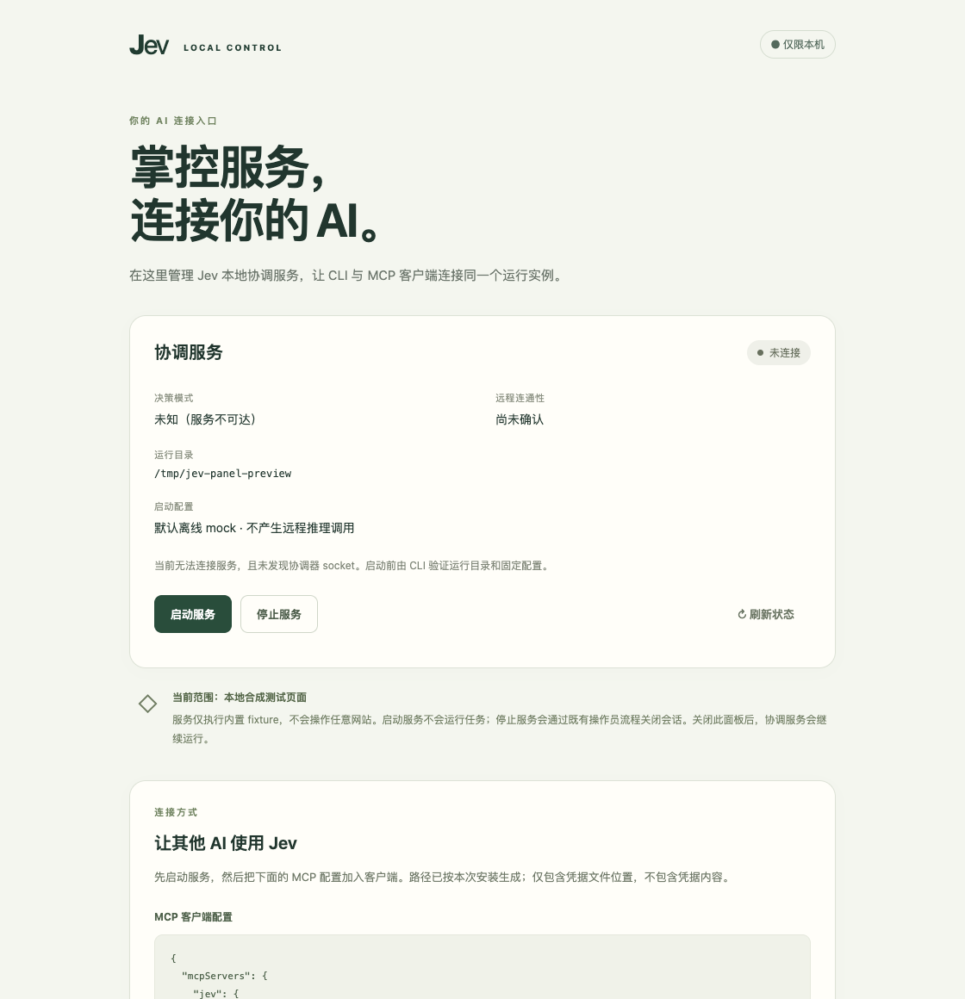

# S13：本机操作面板与其他 AI 接入

日期：2026-11-01（Asia/Shanghai）。此阶段不调用付费模型，不延长或重置任何历史测试预算。

## 当前接入能力

本次通过 GitHub CLI 核实 `giuliano1101/jev-fast` 为 PRIVATE。其他 AI 需要仓库读取权限，并需要在执行机器安装和运行服务的权限；仅浏览 GitHub 不会建立本机连接。CLI 和 MCP 都经同一个本地协调服务、执行器和持久账本，不是独立的远程桌面服务。

本次补齐根目录 `AGENTS.md` 与 `docs/quickstart-agent.md`，提供可移植安装步骤、实际模式核验、MCP 宿主配置、六工具用法、幂等/UNKNOWN 规则和排障入口。修正旧 MCP 说明里“服务只实例化 MockProvider”的过时表述。

正式主接口仍只接受 `standard` fixture 的十二类合成任务。真实网页、抖音和 Android 适配器仍属于独立研究入口，不能因添加面板而声称已支持任意真实应用。第二实体设备的跨机器验收尚未执行。

## 操作面板的控制范围

显式启动的回环 HTTP 面板以固定 CLI 参数调用原有服务的 start、doctor/health 和 stop。操作员在启动面板时固定 runtime 与可选私有 profile 文件路径；网页不能提交任意 shell、路径、provider、API key 或预算配置。

启动面板不会启动协调服务，也不会运行 demo 或目标。默认 mock；真实 Jev 仍需操作员准备 remote profile、网关、登记身份及当前批准。停止复用已有 kill/cancel/drain 生命周期，保留审计和 UNKNOWN。退出面板或关闭标签页不会隐式停止协调服务。

面板给出本安装对应的 MCP 连接配置，仅含可执行文件和凭据文件路径，不包含 token 内容。服务重启后宿主需重新连接读取新凭据。

访问保护采用 loopback、精确 Host/Origin、本次面板令牌、禁用跨域/缓存/referrer 和 CSP。保护范围仍是同用户逻辑边界，不抵御已经拥有同一用户文件权限的恶意进程。

macOS 提供根目录 `打开Jev控制面板.command`，双击后检查 Node、编译当前代码并打开面板。它不会安装依赖、启动协调服务或执行目标；默认运行目录与原 CLI 一致。面板预览：

## 审查发现与修复

独立规格审查未发现缺项。独立代码审查复现了 HTTP 请求读超时覆盖整个命令的问题：模拟 5.6 秒启动时，连接约在 5.0 秒断开，但后台操作仍继续。修复将绝对 5 秒期限限定于请求体读取，读取完成即清除，保留 CLI 独立 15 秒执行上限。新增回归分别验证超过 5 秒的正常启动/状态查询完成，以及未发送完整请求体仍按时断开且不触发操作。

另修正远程健康元数据的显示：健康响应中的 `transport: remote` 与实际 provider 分开判断，避免把真实 Jev 标为未知，或把远程 mock 网关当作本地 mock/真实 Jev。网页只显示白名单模式，不透传身份或模型响应。

## 验证

最终本机验收：Node 24.22.1，typecheck/lint 通过，单元/核心 **363/363**、集成 **61/61**、安全 **40/40** 全部通过；这些测试集合有交叉，不作为互不重叠样本相加。[机器可读检查](verification/checks.json)与同目录原始日志可复核。

新增面板专项 **13 项**（8 单元、5 集成），覆盖：

- 精确 Host/Origin/随机令牌校验、拒绝跨域/任意请求体/未知命令、固定 CLI argv 和脱敏错误。
- 慢状态查询不阻塞停止、启动/停止串行、命令超时和输出上限、超 5 秒正常命令及未完成请求体期限。
- 真实隔离浏览器启动 mock、CLI 鉴权健康和相同会话状态、真实 SDK MCP 发现六工具并打开会话。
- 刷新后保留本标签访问权限，URL 片段清除、网页不包含协调服务 token、窄屏不横向溢出。
- 退出面板保留服务；重新打开面板后经操作员安全停止，socket/服务锁消失。
- 无效私有配置和配置指纹不匹配时拒绝切换，保留已有服务，不泄露配置内容。
- 远程 mock/Jev/未知 provider 的页面标签。该项使用拦截的健康元数据，**没有**连接或验证真实 hosted 网关。

初次新增功能先见到“缺少控制面板实现”的失败，再完成实现；独立审查发现的慢命令问题也先复现 socket hang up，再验证修复。所有新增验证均使用离线 mock、临时运行目录与隔离浏览器。付费调用 **0**，未读取 API key 用于推理、未批准/续期/重置预算。归档扫描未发现现有 API key、私钥或完整面板访问令牌。

这些结果证明本机控制面板和现有接口接线在本次离线场景可用，不能代替真实应用、第二实体设备或长期运行验收。浏览器预览截图使用模拟目录；最终操作面板不自动开启协调服务。

## GitHub 验证环境迁移

功能提交 `42e6017` 的首次 CI [41241457939](https://github.com/giuliano1101/jev-fast/actions/runs/41241457939) 在开始任何 step 前即被 GitHub 取消。检查注释确认是 macOS 14 runner 的计划 brownout，而非测试断言失败。[官方迁移公告](https://github.com/actions/runner-images/issues/13518)说明该镜像将于 2026-11-02 退役，并列出 macos-15 等迁移选项。

已将 workflow 的 runner 改为 `macos-15`，其余步骤、期限和测试断言保持不变。首次取消的元数据见 [ci-initial.json](verification/ci-initial.json)；迁移后运行结果以当前提交对应的 GitHub Actions 为准。本机完整验收的代码与面板实现未因这次 CI 配置迁移改变。

## 操作说明

- [面板使用说明](../../docs/control-panel.md)
- [另一个 AI 接入说明](../../docs/quickstart-agent.md)
- [CLI/MCP 配置与远程授权](../../docs/cross-machine-cli-mcp.md)
