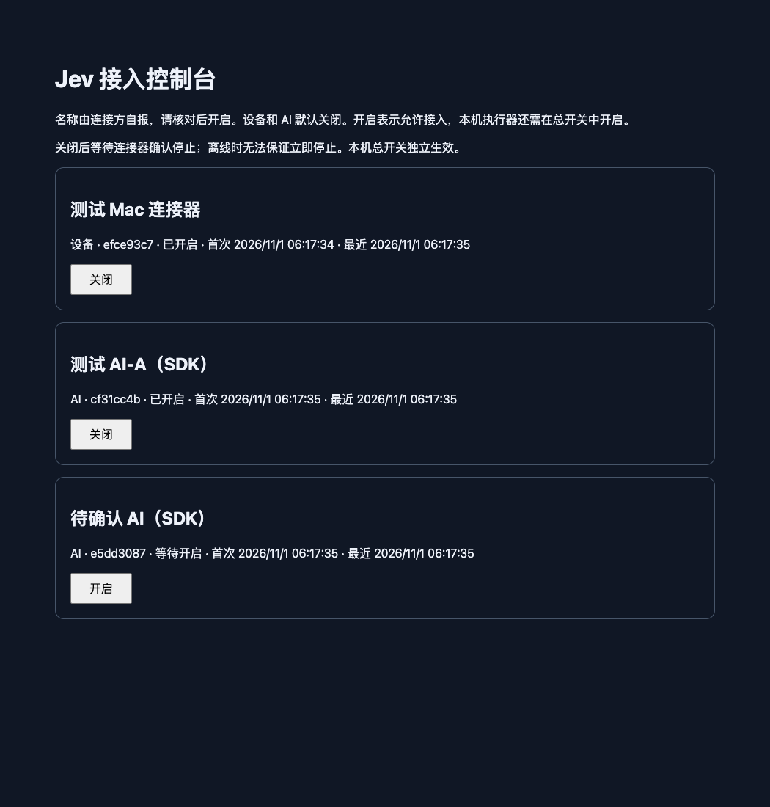

# S15 免 Key 接入与人工开关报告

日期：2026-11-01（Asia/Shanghai）。基于 S14 的94fafee；本轮未调用付费模型，未新增/续期/重置模型预算，尚未部署服务器。

## 用户要求与交付行为

AI 和设备不再需要登录、OAuth 或手动配置网络 Key。新的 manual 模式使用普通 MCP initialize 的 clientInfo.name 和设备自报名称登记，在本机接入控制台显示，默认关闭，由操作员逐项开启。

名称只是标签，没有验证身份；每个实际连接有独立随机编号，同名新连接不继承权限。后台 session/handle 是内部连接能力，不等于实名认证。操作员管理界面仍绑定loopback并保护本次管理链接；公众MCP/设备请求不能批准自己。

初版一个relay选择一个执行器，多个AI有各自核心owner/会话和请求命名空间。开启表示允许接入，不代替Mac本地执行器总开关。关闭先拒绝新请求/排队任务，再取消并收尾；实际停止确认前显示正在停止。云端断线时Mac总开关仍独立，网络owner5秒续租失败会取消。旧Bearer模式与本地六工具保持兼容。

## 测试题

| 题目 | 使用的真实通路与验证 |
| --- | --- |
| 无Key登记与操作员开启 | 实际HTTPS SDK无Authorization + 出站设备连接器；浏览器控制台显示设备/AI默认关闭，开启后选择任务SUCCEEDED；刷新仍保留管理权限 |
| 同名与不同AI隔离 | 同名A/B分别审批，相同request_id独立；B不能读取/取消A会话，新同名实例仍关闭 |
| 单AI执行中关闭/重新开启 | provider等待时关闭，原goal CANCELLED、零物理动作，收尾后重新开启产生新owner；旧请求返回原结果，旧会话不可用，新任务成功 |
| 设备关闭/会话退出/恶意标签 | 设备关闭撤销AI授权，DELETE后新同名session待启用；HTML标签按文本显示，公网自批准请求被拒绝 |
| MCP回应丢失 | 同一实际MCP连接丢失受理回应，按原编号查回结果；选择动作仅一次 |
| 出站连接长失联 | 切断连接器网络，5秒本地租约后目标取消且无点击；原设备确认收尾后手动重新开启，新任务正常 |

另外的单元与故障注入覆盖：默认关闭和代次、目标设备/执行器绑定、错误代设备确认拒绝、未完成open撤销、关闭失败重试、撤销并发收尾、历史容量上限、运行目录重复连接器、私有配置/管理边界、旧模式回归。

## 审查与实测发现的修复

1. 原来网络执行全部归client-a，已改成各AI授权代次的独立核心owner，禁止跨会话读取/取消/执行。
2. 旧设备停止确认可能被新设备替代，已绑定原设备与执行器实例；不同设备不能替别人证明停止。
3. 并发reconcile和撤销可能提前返回，已共享/等待收尾Promise；容量到顶仍允许撤销已有授权。
4. 撤销中打开浏览器且清理失败时可能遗失分配，已保留失败allocation并重试，直到真实close成功才确认；包含ledger已保存/已标关闭的回归。
5. 心跳曾把派生的设备“正在停止”显示状态写回原始记录，导致确认后仍不能开启；已分开原始/展示状态并兼容清除缓存状态。
6. 普通跨会话UNAUTHORIZED错误曾被当作授权失效，已只针对真正OWNER_REVOKED失效，正常隔离错误不自动关闭AI。
7. 同一runtime多连接器可能互相reconcile撤权，新增先于登记/收尾的runtime独占锁；不同journal的第二进程被拒绝。
8. 控制台改为POST状态请求以获得浏览器Origin、保留本标签访问能力并检查字节长度；页面只使用安全文本渲染名称。

## 验收

最终验收：Node24.22.1，typecheck/lint通过；单元/核心 **392/392**、集成 **77/77**、安全 **40/40** 全部通过。新增手动接入专项16个单元与6个集成测试。集合有交叉，不将三组计数相加作为独立样本。[机器可读检查](verification/checks.json)与原始日志位于verification；source_hashes对应实际验收源码。

所有验证使用合成fixture/离线mock，不作为任意网站/手机的成功率结论。已扫描新增公共源码/文档/日志，没有发现现有API key、私钥、硬编码网络token或完整操作员链接。

以下预览使用明确标注的测试SDK名称，不表示商业AI产品已完成接入：

## 使用与边界

- [免Key接入操作手册](../../docs/manual-admission.md)
- [部署准备](../../docs/server-deployment.md)与[手动/旧Bearer模板](../../deploy/network/)
- 接入无身份验证，不能靠名称证明归属；新连接默认关闭是人工授权流程。
- 会话终止/relay重启/设备失联后需核对或重新开启，不通过名称恢复权限。
- 管理端口只监听127.0.0.1；服务器部署后经操作员隧道/已登录控制台访问，不暴露公网自审批接口。
- 仍是本机回环HTTPS/真实SDK/隔离浏览器验证；未公网部署、未Linux实机/实体第二设备验收，未扩展任意真实应用。
- 正在停止时不能承诺物理动作已经回滚。不同设备不能清除旧设备待确认记录；保留UNKNOWN和完整审计。
