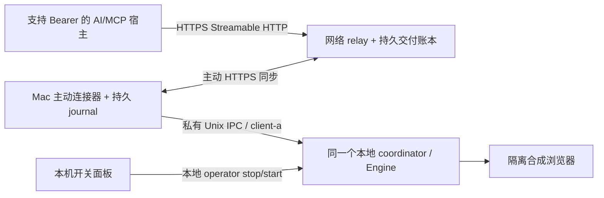

# S14 网络 MCP 与本机连接器完成报告

日期：2026-11-01（Asia/Shanghai）。基于 S13 提交 d5a29dc 开发。本轮付费模型调用0，未新增、续期或重置任何模型预算。

## 完成的结构

网络 relay 提供实际 SDK 的 Streamable HTTP MCP，不是把普通 JSON API 改名为 MCP。它只保存交付状态，实际动作和后验仍由 Mac 原执行器负责；本机没有新增入站控制端口。

初版每 relay 固定一个 device/agent profile，MCP 与 connector 使用独立、可过期的预配 Bearer token。网络六操作需要 `{request_id, params}`，新增 network_status/request_status 两个只读工具；本地 CLI/stdio 六工具保持原参数。MCP 先返回受理状态，再通过固定 request_id 查询结果，与本地同步返回形式不同。

## 断线与本机开关

- relay 在交付前持久化 DISPATCHED；丢失交付不重新派发。
- connector 在 IPC 前持久化 claim，在结果上传前持久化本地 reply；断线只重传保存结果。
- 同请求编号、同规范参数返回已有记录；换参数冲突。goal_id/idempotency_key 仍由原核心约束。
- 本地 service.local_health 给出不依赖模型网络检查的随机实例编号。连接器在同一次操作里使用同一份新读取凭据做预检和派发，防止 off/on 时换用新凭据跨实例执行。
- 云端没有启动本地服务、operator stop、shell、provider 或预算修改工具。本机面板直接 kill/cancel/drain，云端断网时也有效。
- 网络 UNKNOWN 只说明交付/结果不确定；COMPLETED 只表示收到本机 reply。真实 goal UNKNOWN 保持隔离，不因网络完成而变成成功。

## 实际测试题与证明

| 难度 | 题目 | 验证证据 |
| --- | --- | --- |
| 简单 | HTTPS SDK 初始化、工具发现、连接器打开表单并完成中文表单 | 实际隔离浏览器 SUCCEEDED；CLI 健康及本地 stdio 六工具兼容 |
| 简单 | 独立进程按部署私有配置运行服务端与连接器，完成选择任务 | 实际 HTTPS SDK 及浏览器一项动作；正常退出释放自己的锁，stdout不含token |
| 简单 | help/import 与错误进程参数 | 不启动服务、不读隐式模型密钥，错误非零退出 |
| 中等 | 错误凭据/角色、Host、Origin、超限及非规范合成输入 | 派发前拒绝；没有本地动作，未存入不允许的输入 |
| 中等 | 新 MCP 连接重复相同 request_id，及同编号改参数 | 相同结果、动作和账本条目不增加；改参数冲突 |
| 中等 | 目标运行中发取消/状态请求 | 连接器心跳和控制通道继续工作；目标 CANCELLED，零动作 |
| 复杂 | connector 结果上传持续失败，保存结果后重启 connector | 重连上传原持久 reply，浏览器动作数不增加 |
| 复杂 | relay 已持久交付，但交付响应在连接器收到前被切断，再重启 relay | 原请求网络 UNKNOWN，不再次交付；本地没有产生旧会话 |
| 复杂 | MCP 响应在 relay 受理后丢失，换新 HTTP 客户端恢复 | 原 request_id 查回 SUCCEEDED；原选择动作只有一次 |
| 复杂 | 云端连接切断时用真实本机面板停止活动目标，再开启服务 | 停止时没有发生动作；实例变化、旧排队请求 REJECTED；新目标可完成 |
| 异常 | 真实动作完成后模拟执行返回丢失 | 原核心 goal/action UNKNOWN；同键/新网络编号不重放，新 goal 被 QUARANTINED |

上述内容归入10个集成测试用例。另有网络单元/协议/存储/配置测试，覆盖规范化默认值、重启状态、nonce/结果冲突、损坏/不安全/身份不匹配的存储、未完成claim、结果期限、私有文件、身份分离与local_health。

重要边界：心跳是缓存租约，断线或切换后可能短暂显示旧状态；执行仍重新检查本机实例。测试首次使用“ready就绪即认为已经是新实例”的等待方式得到失败，随后改为等待新实例编号心跳；没有降低实际动作断言。短期未知连接状态下可出现 QUEUED，租约、队列TTL及本机实例检查共同阻止失效任务执行。

## 审查发现与修复

- 重复 Authorization 原始头最初被接受：回归先失败后修复，现要求唯一授权/Host、最多一个 Origin。
- 错误 TLS key/cert 在 HTTPS 构造失败时原先会遗留 relay owner.lock：已统一启动清理，保留审计并释放仅本次取得的所有权。
- HTTPS listener 被外部关闭时 close 报错原先可能跳过 store 释放：已用 finally 保证释放。
- connector 终止鉴权/fencing 失败原先静默以0退出：现通过安全 failureCode 非零退出，实际401/409子进程回归验证只输出错误码，无 token/响应正文。

独立规格审查与代码质量审查均在修复后通过。

## 完整验收

最终验收：Node24.22.1，typecheck/lint 通过；单元/核心 **376/376**、集成 **71/71**、安全 **40/40** 全部通过。新增网络专项为13个单元与10个集成测试。原始日志与[机器可读检查](verification/checks.json)保存在 verification，测试集合有交叉，不把三组测试数相加当作独立样本。完整集成回归约84.5秒，验证使用离线 mock，不能解释为 hosted Jev 的速度或成功率测量。

公共新增源码/文档/日志扫描未发现现有 API key、私钥、完整面板令牌或硬编码网络 token。source_hashes 记录实际验收源码；没有部署真实服务器，也没有修改旧预算。

## 部署交付与限制

[网络使用手册](../../docs/network-mcp.md)、[服务器准备/部署说明](../../docs/server-deployment.md)与[部署模板](../../deploy/network/)已准备。尚未登录或部署任何真实服务器；等用户提供已登录控制台、指定服务器、域名/HTTPS与首个 AI 宿主后再操作。不需要把账号密码或模型API key粘贴到聊天。

本次是同一台 Mac 上的回环 TLS、实际 SDK、独立进程和隔离浏览器验收，不是物理双机或公网长期验证。没有真实站点/App/Android接入、Linux/systemd实机验证、OAuth自动发现、多设备选择或token自动续期。当前私有 Bearer 只承诺已验证的显式 Header 客户端。

连接器正常切换需等待旧租约过期；异常退出残留锁按手册确认原进程死亡后人工恢复，不能自动删锁或清账本。规范化 outcome 超过24,000字节时保守网络 UNKNOWN，不截断/重放。网络 token/租约/TTL依赖正常同步的系统墙钟，未实现网络层回拨防护；本地核心原单调时钟动作预算保持不变。
