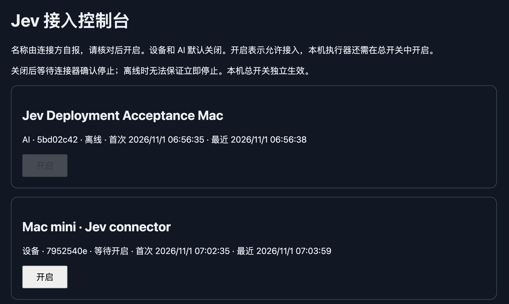

# S16 公网部署与 Jev 辅助操作报告

日期：2026-11-01（Asia/Shanghai）。本阶段已使用用户在 Chrome 指定、已登录的服务器完成部署，没有购买服务器、域名或证书。公网发布由用户在实际发布步骤前确认。

## 当前可用结果

- MCP：**https://jev.43-160-233-161.sslip.io/mcp**，Streamable HTTP，无 Authorization/OAuth/网络 Key。
- 新设备/AI 默认关闭，由用户在私有接入控制台核对自报名称并手动开启。Mac 连接器已经登记，本机总开关保留原来的关闭状态。
- 私有管理台通过现有 SSH 身份转发到 Mac `127.0.0.1:47832`，已在 Chrome 打开。没有新增或修改 SSH 凭据、认证或云防火墙；管理端口不公开。
- [实际使用说明](../../docs/public-service-quickstart.md)包括AI接入、两个开关、连接器/隧道重启及当前能力范围。



## 架构和安装来源

指定服务器实际为 Ubuntu24.04.4、x86_64、2核、约4GB内存。复用已有 Nginx/Certbot，新增一个独立虚拟站点，没有替换既有站点或系统 Node。

```text
AI → 公网 HTTPS443 /mcp → Nginx → 校验证书的 HTTPS127.0.0.1:8443 → relay
Mac 主动连接器 → 同一公网 HTTPS → relay
用户 Chrome → Mac127.0.0.1:47832 → 已有身份的 SSH 隧道 → 私有接入控制台
```

relay 使用专用非登录用户 `jev`，配置/证书/密钥为0600、直接父目录0700，状态和日志保留私有。Node24.19.0从官方 nodejs.org 下载并比对官方 SHASUMS；单独安装在 `/opt/jev-node-v24.19.0`。源码和依赖构建以非root进行，安装代码变为root所有、只读。浏览器和模型不在服务器运行。

服务器使用已经验收的 S15 源码包：

- 源码提交：`63ca18d874dae5f87975017314853fd55c2415a2`。
- 包大小：1,815,637字节；本机与上传后SHA256一致。
- 包SHA256：`46836657b91c3a79bfbd3fdc4d2889f9c6cda310419e372860dfbd7e5200b12d`。
- 最终部署辅助脚本SHA256：`49c96815dd109bf67042d44595575935bf8d837e56c96a543887b5df4cec500f`。

本次 Git 更新新增部署脚本、研究选择器、测试/说明和证据，正式服务源代码未变。导出的源码构建没有 `.git`，构建元数据会标记 `unversioned`；来源通过上面的校验包和只读 `prepared.json` 记录，不伪造 Git checkout 元数据。

域名使用 [sslip.io/nip.io](https://nip.io/) 的 IP 映射服务，无需注册账户。它不是自有注册域名；IP变化需换域名/证书，可用性依赖公共DNS。实际公网证书由 Let's Encrypt 签发，已通过Mac的正常信任校验，有效期2026-10-31至2027-01-29。Nginx对本机后端同样验证证书，没有关闭TLS验证。

## 实际验收

[公网协议检查结果](public-probe.json)来自 Mac 的真实 TLS 客户端及 MCP SDK1.32.2，不是mock：

| 检查 | 结果 |
| --- | --- |
| TLS信任、域名及证书有效性 | 通过 |
| 公网 `/health` | HTTP200，`ok:true` |
| 无Authorization初始化MCP | 通过 |
| 工具发现 | 6个动作工具＋2个状态工具 |
| 新AI状态 | `pending`、`enabled:false` |
| 未开启时调用open_session | `ADMISSION_REQUIRED`，未执行 |
| 公网 `/api/status`、`/api/admission`、根目录及未知路径 | 全部404 |
| 本机后端和管理监听 | 仅127.0.0.1:8443 / :47832 |
| 私有SSH管理台 | 已在Chrome正常显示连接和手动开关 |
| Mac连接器 | 真实公网登记，等待开启 |
| 既有IP入口健康检查 | 发布后仍HTTP200 |
| 按原Nginx配置读取域名的独立站点检查 | HTTP200 |

Certbot续期使用webroot，既有续期timer存在，新deploy hook只匹配本证书再验证/reload Nginx。尚未等待真实证书到期后的续签。服务没有配置自动重启或开机启动；异常退出保留账本/锁，不能通过清库恢复。

[恢复记录](recovery.json)：暂停本轮未授权、无任务的Mac连接器，再恢复同一进程；界面显示同一设备编号依次 **等待开启→离线→等待开启**，没有自动取得执行权限。此检查验证真实公网心跳失联/恢复；它不等于已批准任务在途丢包、动作撤销、进程崩溃或实体第二台电脑验收。

本轮没有替用户开启设备/AI，也没有在公网批准并执行fixture目标。已有本机/故障注入回归继续验证这些执行逻辑；上线后首次已授权真实任务仍需用户手动开启并验收。

## Jev 实际参与的操作

新增的[固定部署研究选择器](../../bench/deployment/README.md)仅接收有限阶段、布尔检查状态和固定候选ID；没有发送服务器地址、账户、源代码、截图、原始AX或管理令牌。密钥只留本机私有文件，没有上传服务器或GitHub。

用户另行批准最多50次（含失败）、$0.10、24小时。使用独立私有账本，每次调用前持久预留$0.01，因此本阶段实际最多允许10次尝试；旧预算未复用或续期。

[7次原始脱敏选择与执行记录](jev-decisions.json)：

| 次序 | Jev选择的步骤 | 主机实际执行及后验 |
| --- | --- | --- |
| 1 | verify_dns | Chrome云终端确认域名解析到指定服务器 |
| 2 | inspect_listeners | Chrome检查计划的两个私有端口没有冲突 |
| 3 | prepare_private_relay | Chrome运行已校验、复审后的限定恢复/构建脚本 |
| 4 | verify_private_health | Chrome独立验证健康、nonroot、0600文件及loopback隔离 |
| 5 | publish_https | 用户操作时确认后，Chrome运行新站点发布/证书签发 |
| 6 | verify_public_mcp | Mac TLS客户端与SDK验证公网MCP及默认拒绝执行 |
| 7 | inspect_operator_route | 私有SSH隧道＋Chrome管理台，显示待开启Mac连接器 |

7次响应合法，7个主机步骤后验通过；首题在两个只读候选中选择，其余为当前阶段唯一候选，不能用来估计通用决策准确率。首题置信度0.88，其余1.00；每步均由主机独立审核并验证，并未修改正式Engine的0.90策略。

共3334输入/208输出token，用量未知0次；按项目现有费率折算已知费用 **$0.000140028**，保守预留 **$0.07/$0.10**。单次选择平均约930ms，范围772–1104ms。该时间包含预算预留、模型请求和响应校验，不包含UI执行；没有computer-use速度对照。

这是实际Jev选择＋固定主机动作的窄研究通路。它不是正式Engine对任意云控制台的通用控制能力，也不声称全部准备步骤由Jev执行；前期环境检查、上传、诊断和修复由普通CUA/工程工具完成。

## 发现、修复与验证

1. 独立审查发现新建ACME目录受0077 umask影响会变成0700；修复为只对新建webroot显式设0755，保留已有目录权限，并增加真实umask回归。
2. 首次Ubuntu私有安装因精简PATH遗漏 `/usr/sbin` 而找不到 `runuser`，停在npm构建前。当时只有专用用户和官方Node存在，服务/配置/账本/公网站点均未创建。修复为预检时解析绝对启动器路径，增加原故障的可执行复现测试。
3. 为上述已人工核对的Node-only部分状态增加显式限定恢复：重复验证源码和官方Node下载，完整比对已有Node路径/类型/内容/所有者/权限/链接，再继续构建；拒绝任何其他已有安装/审计状态，不删除或覆盖它们。修复后实际部署、独立健康检查和公网发布均通过。
4. 全套并行测试暴露旧“丢失动作响应”测试的50ms竞态：持久化可能在执行前耗尽期限，合法UNKNOWN不保证动作已经发生。改为明确先提交副作用、再抛响应丢失错误；保留独立的挂起/超时覆盖，并加强UNKNOWN账本、隔离、同键不重放断言。未改变Engine或放宽产品期限。

原验证过程保留：两个旧50ms断言失败、一轮本地导航1500ms超时、修正后中途一次CLI烟测30s取消。后续默认并行全套、完整集成和安全回归均通过；没有用串行结果替代最终默认命令，也没有清除失败后重写成绩。

| 最终离线检查 | 结果 |
| --- | --- |
| npm run typecheck / npm run lint | 通过 |
| 默认并行 npm test | 405/405 |
| npm run test:integration | 77/77 |
| npm run test:safety | 40/40 |
| Python部署工具测试 | 16/16 |

Node集合有交叉，不能相加成独立样本。日志见[verification](verification/)，部署选择器13项测试包含在405项中。新增Python检查也已接入GitHub CI。本阶段未做长期负载、任意商业宿主、已批准公网在途任务或物理第二电脑验收。当前正式能力仍是十二道固定合成fixture。
