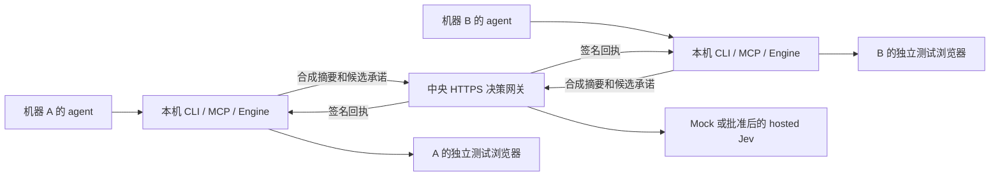

# S10 架构、发布与后续验收

本阶段在 S9 提交 `8e7626254dd291df96d4cba4ea18845c7007aa2d` 上继续开发，未用最初审查提交覆盖后续手机与混合执行代码。命令及配置格式见 [CLI / MCP 手册](cross-machine-cli-mcp.md)。

## 数据如何流动



图表示设计拓扑。本阶段实际测试为同一台 Mac 上的两个逻辑设备、两套本地执行器与两个浏览器，不是两台实体电脑。

本地执行器绑定实际节点及参数，以随机本地盐生成承诺；远程请求不包含原始 DOM、实际输入值、坐标或 selector。中央只能从白名单候选选一个。返回回执绑定 owner/device/agent、会话、目标、租约、快照、完整请求摘要、候选及 nonce。网关签发的有效窗口从请求进入时开始；`issued_at_ms` 表示该窗口起点，等待模型不会获得新期限，也不会被重复扣时。本地用 Ed25519 公钥验证签名，以单调时钟约束最迟执行时间，再检查目标、前后置条件。回执在动作转入 EXECUTING 的同一账本事务中消费。适配器在异步验证完成后、物理操作前再次检查许可。

## 已实现的范围清单

| 范围 | 操作 | 执行策略 | 回退 |
|---|---|---|---|
| `fixture-v1`、本机动态 loopback origin、`standard` 合成页面 | fill / click / select / scroll / wait / back | 远程 `required_jev` 必须有 Jev 路由回执；独立测试 profile 可用 `test_mock` | 无自动替代执行器 |
| 本地 mock profile | 相同合成操作 | 明确离线测试模式，无远程回执 | 不自动由远程 profile 降级到此模式 |
| 任意真实网页、原生桌面应用或手机 | 不属于 S10 主流程 | 拒绝；S7/S9 研究脚本不等于正式接入 | 不借 `FALLBACK` 绕过 |

该清单描述代码中的固定路由，不能通过编辑文档增加权限。所有 profile 都标为 `advisory-only`：本项目没有撤销宿主的 shell、CUA、其他浏览器工具或同用户进程权限。`required_jev` 只约束经此 Engine 的动作。尚未实现批准后的替代 route，也没有即时全局撤销已发出短期回执的能力。

## 可靠性与限制

- 每个本地协调服务最多一个开放会话、一个活动目标；公开六工具仍是原来的严格输入契约，最多 8 步 / 60 秒。
- 内部请求最多 24,000 字节、响应最多 64,000 字节；请求/快照/回执均不超过 2 秒。错误不会扩大旧许可期限。
- 网关双向 TLS 验证设备证书；签名 token 绑定该证书和身份，scope 只有 `decide:synthetic`，最长一小时。操作员可登记、续期和吊销。
- 网关最多 64 个连接、4 个并发请求、每主体一个在途决策，每主体每分钟 60 次请求；健康查询也计数。满载直接拒绝，没有持久公平队列。
- SQLite WAL + FULL 同步保存预算、登记和决策幂等；每次 hosted HTTP 尝试前持久预留费用，包括允许的限流重试。重复键异输入拒绝；已完成返回原回执，不重新签名延长有效期。已有 pending/unknown 不重新派发。
- 预留金额是保守上限，不是供应商账单。当前网关不自动回收预留，不做付费成本预测；已知费用和未知结果须在 pilot 报告中分别核对。
- SQLite 同步事务可能阻塞事件循环，故每次关键存储操作之后再检查期限与吊销。它适合本阶段的有界流量，不能称为高并发生产服务。
- 本地账本合法 JSON 仍需完整 schema、引用、幂等、receipt 唯一性检查。写盘是否成功无法确认时封锁当前实例；重启恢复未决动作为 UNKNOWN。
- `UNKNOWN` 不重放。网络断开先查本地 status；取消只停止后续操作，不能撤销已经发生的动作。离线本地 stop / kill 可用。

## 保留、容量与恢复

本地账本上限 100,000 条会话、目标、动作各自计数；中央决策上限 100,000 条。容量测试见 [测量结果](../artifacts/cross-machine/ledger-capacity.json)。本地 JSON 写入仍需复制和重写完整状态，10 万动作的单次事务已接近秒级；它会消耗 2 秒快照预算。这个硬上限是停止保护，不是推荐运行容量。

当前没有自动清理审计或幂等记录，也不自动轮换到空数据库。未选择长期留存期限前，保留全部记录；在达到容量前由操作员停止服务并离线备份、评估迁移。不要删除旧记录来恢复预算或解除 UNKNOWN。短期可在约 1 万动作时检查文件大小、写入延迟和业务窗口；是否迁移 SQLite 本地执行账本须基于真实持续负载，不能用一次容量测量宣布已解决。

备份中央 SQLite 前先正常停止网关，保留整个私有状态目录（包括可能存在的 WAL/SHM），不要仅复制仍在写入的主文件。本地进程崩溃时，按照既有 [恢复说明](mcp.md) 核实旧进程已退出，保留账本后处理锁；不自动删除锁。未知/损坏 schema、丢表、错误版本拒绝启动。

## 版本兼容与回滚

| 组件 | S10 版本 / 规则 |
|---|---|
| 公共六工具 | 原 P0 契约；未扩展为任意应用操作 |
| 内部判断 / 回执 / token | `decision-v1` / `receipt-v1` / `token-v1` |
| 策略 / 适配器 | `p0-v1` / `fixture-v1` |
| 本地账本 | v2；可验证并原子迁移旧 v1；v1 不允许 receipt 字段 |
| 中央存储 | SQLite `user_version=1`，完整表定义和内容校验 |
| SDK / 模型 | 锁文件 MCP SDK 1.32.2；mock-v1 或 jev-1.14.0 |
| 运行环境 | Node 24.19+；实际测试 macOS arm64，其他系统待验收 |

未知协议/策略直接拒绝；没有宣称 client N/server N-1 自动兼容。S9 的旧程序只识别账本 v1，不能直接读取 S10 v2。回退时停止服务、保留全部账本与中央状态，选择明确支持 v2 的修复版；不要降级数据或恢复到执行前的旧备份后重放动作。可以保留独立 mock 测试目录，但不能拿它替代生产历史。

从已验证且干净的 Git 提交生成源码校验包：

```sh
npm run release -- pack --out .runtime/releases/s10
npm run release -- verify --manifest .runtime/releases/s10/manifest.json
```

只打包 Git HEAD 的受版本控制文件，不打包 `.runtime`、私钥、node_modules 或浏览器。命令要求工作区干净；输出路径必须尚无同名包/manifest。输出包含完整 revision、SHA-256、大小和兼容版本。收件方须通过可信渠道核对 manifest，再校验包、解压、安装锁定依赖、构建并运行离线测试。`verify` 只核对文件名形式、字节数和 SHA-256；输出的 revision 和兼容性字段不能当作已经验证了包内源码或版本兼容。校验和用于发现传输损坏，**不是发布者签名**；没有自动发布或更新服务。`verify` 不解压、不安装也不执行包内文件。

## C–E 后续验收条件

C 已在用户新批准范围内完成一次本机 hosted 合成试验，结果和未达到的稳定性要求见 [C 报告](../artifacts/cross-machine/pilot/report.md)。下列为各阶段的条件；D/E 按用户要求留待以后，不能把本阶段报告当作已经上线：

1. **C，hosted 合成 pilot：** 确认设备、期限、请求上限、成本上限和每次预留额后，配置 gateway live 与本地 required_jev。S9 安卓预算不自动转作此用途。先少量预热，再固定题目重复测量，包含所有失败；记录端到端 p50/p95、成功/拒绝/未知数、保守预留和供应商已知费用。不得用 mock 速度推算 hosted 成绩。
2. **D，一个真实应用：** 用户选择应用和 2–3 个低风险动作、允许发送的观察字段和留存期，再实现独立 production schema 和受控 adapter，验证弹窗、目标变化、恶意页面指令、人工干预和未知状态。当前 strict synthetic 协议故意拒绝真实数据，不把真实内容改标 synthetic。
3. **E，实体逐机接入：** 提供第二台机器/agent 和已批准的网络访问范围，先单机 canary，再第二机。逐机记录 OS、产品版本、权限、凭据和构建摘要、实际工具隔离、停止/撤销/回滚结果。没有 OS 隔离证据继续标 advisory-only。

这些条件分别决定网络、数据和付费范围。本次只创建过自动测试用短期证书与本地临时服务，均由测试清理；没有注册生产设备、开放跨机端口、设置自启动或安装全局 skill。
