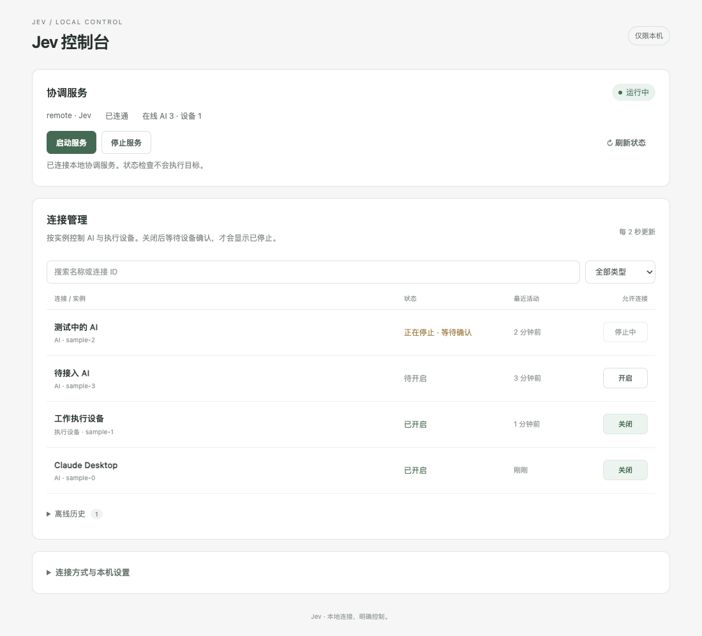

# 统一控制台完成报告 · 2026-11-02

原先服务总开关和 AI／设备接入管理位于两个页面，历史离线记录与当前连接混在一起，技术配置占据主界面。本轮将日常控制合并到一个本机页面，并已在原 Mac Chrome 打开。

## 现在这一页可以做什么

- 顶部查看实际服务状态、真实 Jev 模式与连通性，启动、停止或刷新服务。
- 中间管理当前 AI／设备，每个实例独立开关；按名称或完整编号搜索，筛选 AI／执行设备。
- 离线历史默认折叠，不删除任何记录；只显示短编号，完整编号保留在提示与搜索中。
- 连接说明同页展开：复制公网 MCP 地址，查看本机 stdio 配置、CLI 命令、运行目录与固定配置状态。

每两秒刷新，不替换未变化的连接行，保留焦点、输入和展开状态。操作开始及结束均使旧读取失效，旧列表／错误不会覆盖新开关状态。停止中等待原有撤销确认，不把“已点关闭”当成“已经停止”。

## 预览

下图为离线合成示例，不是线上账户／连接截图。

[手机窄屏示例](../../artifacts/unified-console/mobile.png)。390px 测试无横向溢出。

## 接口与部署

统一控制台服务端使用原有 loopback 管理接口，转发地址由操作员私有配置固定；每次读取已有私有令牌文件，支持轮换。浏览器不接收上游管理能力、owner、grant 或 local-instance 元数据，也不能指定上游地址、路径、provider 或任意命令。未配置和配置后不可达分别显示，不伪装成空连接列表。

只更新了本机面板进程，并恢复原来已断开的 SSH 管理隧道。协调器、真实模型网关、网络连接器和费用账本未做重启或策略修改。原服务页／接入页私有快捷入口现指向同一页面，Finder 启动器优先复用该入口。原 relay 管理接口保留为后台维护能力，日常不再需要另开页面。

本机实际验收：服务为 `running / remote / jev`，模型网关可达，管理桥已连接。验收快照读取 351 个连接，其中 342 个离线历史折叠、9 个当前连接；数量会随其他 AI 活动变化。已在 Chrome 实际验证名称搜索及恢复默认总览，并关闭重复的旧服务标签页。没有为验收关闭正在使用的其他 AI，也未在共享实例上执行服务停止。

## 测试结果

| 检查 | 结果 |
| --- | --- |
| TypeScript / lint | 通过 |
| 单元测试 | 505/505 |
| 集成测试 | 110/110 |
| 安全测试 | 40/40 |
| Python 部署测试 | 16/16 |
| 独立规格审查 | 通过 |
| 独立代码质量审查 | 通过，两个旧读取竞态已修复 |

测试无跳过，无付费模型调用。新增覆盖包括真实临时 HTTP 管理代理、0600／令牌轮换／不跟随重定向、Host／Origin／能力保护、按精确实例开关、停止等待 ACK、150 条历史折叠、XSS 文本、搜索与类型筛选、聚焦节点不丢失、过期成功和失败读取、慢列表不阻挡停止、390px 布局，以及 Chromium → 统一面板 → 管理 HTTP → 实际准入账本的完整离线链路。原生命周期测试仍验证临时 CLI/MCP 服务确实启动、共用并停止。

[机器可读检查](../../artifacts/unified-console/checks.json) · [部署健康快照](../../artifacts/unified-console/deployed-health.json) · [使用说明](../control-panel.md)。发布提交的 CI 结果以 GitHub Actions 为准。
